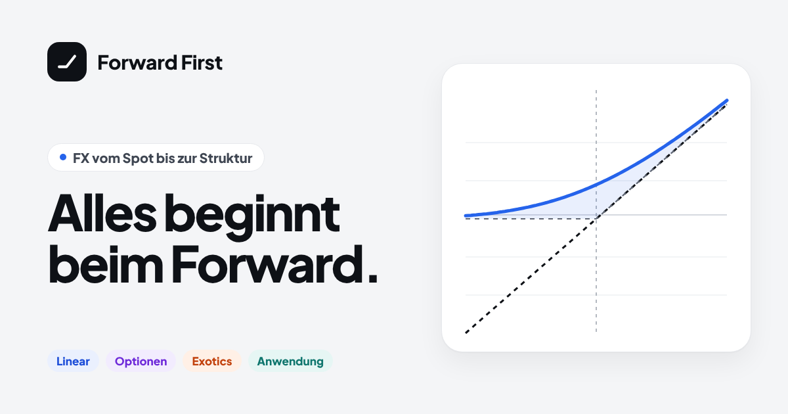

# Forward First

**An interactive learning tool for the FX market — from spot and forwards to options, the six Greeks and structured products. Everything is reduced to the forward.**

German with English technical terms, fully switchable to English. Every number on screen is calculated live by a tested calculation core; a Riskometer shows real market swings from ECB reference rates.

**One offline file.** Forward First ships as a single `forward-first.html` (about 1.6 MB) that runs without a network connection: double-click it on a PC (Chrome or Edge) or open it in the iPad Files app. No hosting, no login, no tracking. Download it from the [latest release](../../releases/latest).



> For educational purposes only. Not investment advice.

## What it is

Nine modules that build on each other, all telling the same story — a Swiss importer who has to pay USD 1 million in three months:

| Family      | Modules                                                       |
| ----------- | ------------------------------------------------------------- |
| Linear      | 01 FX market & spot · 02 Forward · 03 FX swap                 |
| Options     | 04 Vanilla options · 05 Greeks · 06 Combos & volatility smile |
| Exotics     | 07 Barrier & binary · 08 Structured products                  |
| Application | 09 Hedge, alpha, yield                                        |

Each module has four sections (intuition → interactive core → worked example → collapsible derivation → "on the desk" → key point), a check question after every section and a four-question quiz. Progress is stored only in the browser (`localStorage`); where storage is blocked, the tool runs without saving progress.

### Signature interactions

- **Wow moment** (home page): forward → call → time value → put-call parity, morphing on the same axes.
- **Greeks lab**: price and delta curves with live tangents (slope = delta, slope of delta = gamma), all six Greeks with numerical checks.
- **Riskometer**: realised 1-month volatility of EUR/CHF, USD/CHF, EUR/USD and USD/JPY since 2006 as a gauge and a 20-year chart with tappable market events (2008, 2011, 2015, 2022, 2024, 2025).
- **Payoff builder**, **smile builder**, **barrier and touch labs**, **path simulator** for accumulators, TARFs and target profit forwards, **franc-shock replay** with real ECB fixings.

## Stack

Astro 7 (static output) · TypeScript strict · Preact islands · MDX · hand-written SVG charts (no chart library) · embedded font subsets (Plus Jakarta Sans, JetBrains Mono, STIX Two Text) · esbuild + fflate for the single-file build · Vitest · Playwright (Chromium and WebKit) + axe · ESLint · Prettier.

## Architecture

```
src/lib/fx/          calculation core: pure functions, no DOM
  forward, swap, arbitrage, vanilla (Garman-Kohlhagen, Black-76), greeks, implied,
  smile, exotics/ (digital, 8 barriers, touch, double no-touch), mc/ (Monte Carlo)
src/lib/data/        Riskometer maths: realised vol, percentiles, levels, events, validation
src/lib/nums/        named numbers for <Num of="…" /> in the texts (computed, never typed in)
src/content/         module texts (MDX, de/en), quizzes, glossary, facts, sources.md
src/components/      layout, content blocks, Preact islands, figure wrappers
src/i18n/            UI strings per namespace (equal keys enforced in DE and EN)
src/client/          page scripts (navigation, stepper, section end), shared by both builds
src/offline/         runtime of the single file: hash router, island mount, view transitions
scripts/             fetch-ecb.ts, build-riskometer.ts, precompute-mc.ts, build-offline.ts
data/raw/            ECB raw data (versioned)
src/data/fx/         generated JSON (Riskometer, Monte Carlo fair values)
docs/                master prompt, design references, content guide, reference checks
```

**Single-file build.** `npm run build` runs the Astro build, then `scripts/build-offline.ts` packs every pre-rendered page (gzip + Base64), one esbuild bundle with the router and all Preact islands, the CSS and the font subsets (as data URIs) into `release/forward-first.html`. Navigation uses hash routes with the same paths as the site (`#/module/05-greeks/2/`). A Content-Security-Policy (`default-src 'none'`, inline scripts without a hash since D-41, `worker-src 'none'`, `connect-src 'none'`) guarantees that the file makes no network request. Monte Carlo always runs in small chunks on the main thread; View Transitions for the station → module morph are used where the browser supports them. See D-13, D-40 and D-41.

**Number integrity.** Texts never contain typed-in example values: `<Num of="ex.callChf" />` renders "CHF 12’669" from the core. Historical facts go through `<Fact id="…" />` and must have an entry in `src/content/sources.md`. A content lint fails the build otherwise.

## Data pipeline

ECB euro reference rates (USD, CHF, JPY per EUR) → EUR/CHF and EUR/USD directly, USD/CHF and USD/JPY as cross rates → realised volatility over 21 log returns, zero mean, annualised with √252 → percentiles of all daily values since 2006 per pair → five levels (calm < P20 ≤ normal < P60 ≤ elevated < P85 ≤ high < P97 ≤ extreme). Updates are manual: the GitHub Action **Release** (`.github/workflows/release.yml`, Actions → Release → Run workflow) fetches and validates the ECB data, runs all checks, builds and tests the file, commits changed data and publishes a GitHub Release with `forward-first.html`. A validation or test failure stops the run before anything is committed or released. Every page footer shows the data date.

## Tests

- `npm run check` — `astro check`, ESLint, Prettier, Vitest with coverage (≥ 90 % lines in `src/lib`).
- `npm run e2e` — Playwright opens `release/forward-first.html` over `file://` with the network blocked, in Chromium (1440 × 900) and WebKit as an iPad (820 × 1180 and 1180 × 820); any network request or console error fails the test. Smoke tests, hash routing, blocked storage, Monte Carlo without a worker, and every packed page.
- `npm run e2e:web` — detailed component tests on the Astro web build at 390 px and 1440 px, including axe accessibility checks.
- The running example is tested against an independent Python reference (`docs/reference/gk_reference.py`); exotics against independent formulations (method of images, first-passage quadrature, image-sum double no-touch, PDE) in `docs/reference/xcheck/`; Monte Carlo fair values were reproduced by an independent re-implementation.

## Highlights from the decision log

The full log with origin of every decision is in [`DECISIONS.md`](DECISIONS.md). A few:

- Strict separation of numbers from text with a lint that enforces it (D-17).
- A check question after every section in addition to the module quiz (D-18).
- Double-precision normal distribution instead of the prototype approximation (D-20).
- Where the ECB data contradicted a prototype text, the text was changed, not the data (D-31).
- Structured products are always decomposed into building blocks with a loss scenario; their fair strikes come from a seeded Monte Carlo with standard errors (D-28, D-29).

## Run locally

```bash
nvm use            # Node 24 LTS
npm ci
npm run dev        # http://localhost:4321
npm run check      # types, lint, unit tests
npm run build      # dist/ and release/forward-first.html
npm run e2e        # tests of the offline file (add --project=chromium-1440 without WebKit)
npm run e2e:web    # component tests on the web build
```

## Download and release

- **Use it:** download `forward-first.html` from the [latest release](../../releases/latest). PC: double-click, it opens in Chrome or Edge. iPad: tap the download, save it to Files, open it there. If only the loading text stays on screen (no yellow diagnostics box), that view runs no JavaScript; then open the file on a computer in Chrome, Edge or Safari, as the loading text says.
- **New release** (e.g. with fresh ECB data): GitHub → Actions → **Release** → Run workflow. Untick "Fetch new ECB reference rates first" to rebuild without new data.
- Every CI run also attaches the tested file as the artifact `forward-first-html`.

## Credits

Concept and product decisions: Dario Moffa. Built with Claude Code.

## License

All rights reserved (no licence granted) until decided otherwise.
